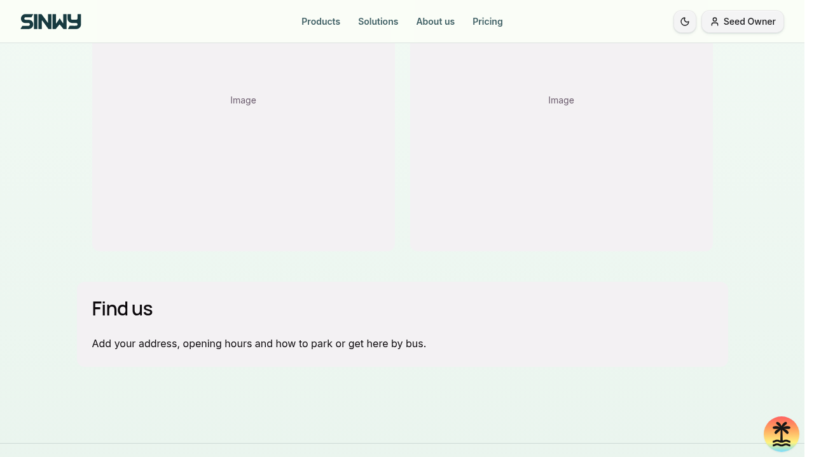
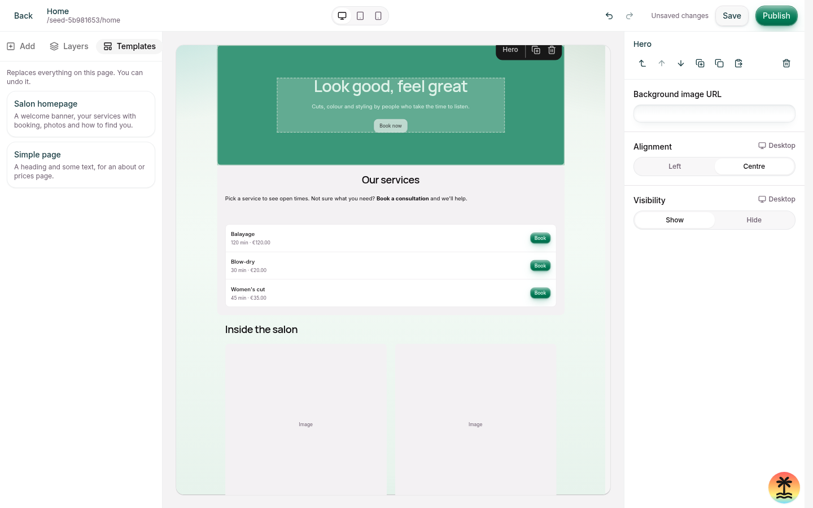
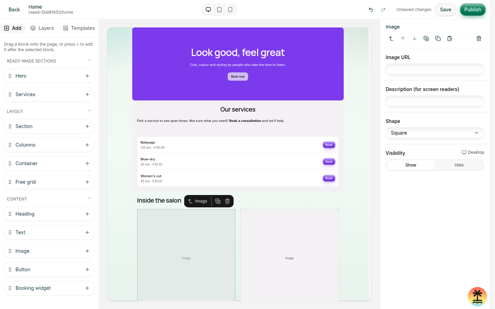
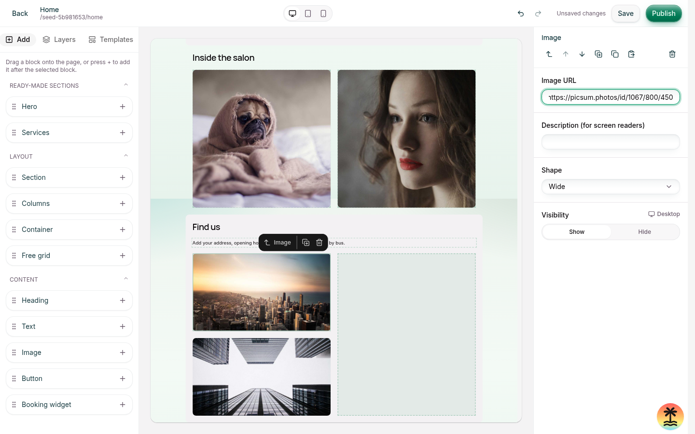
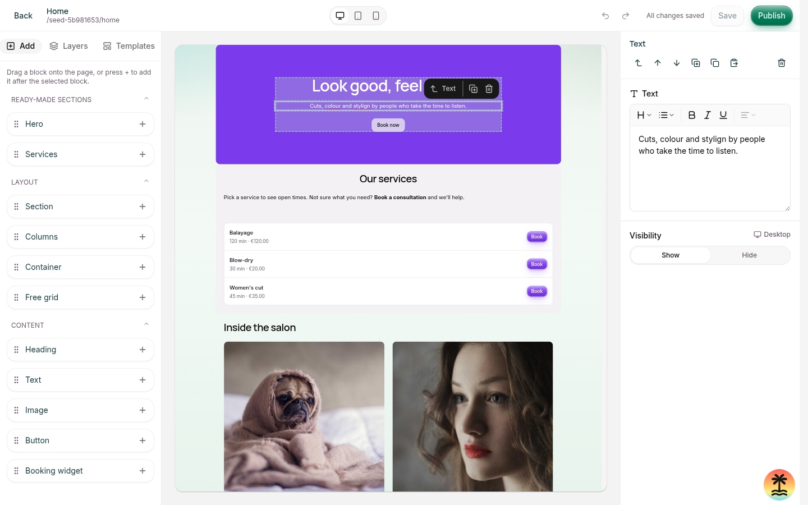
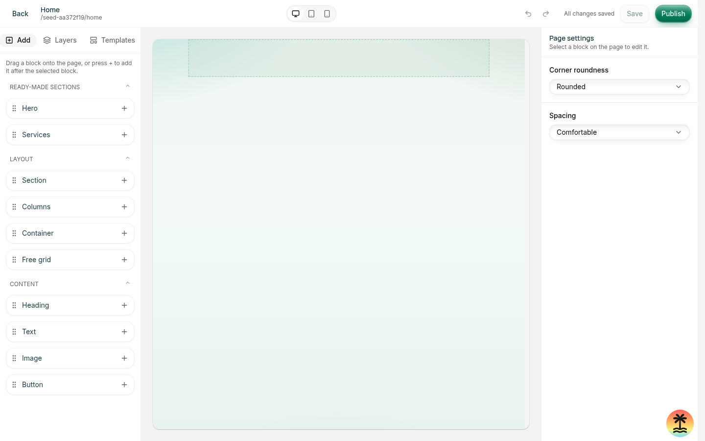

# Puck editor usability tasks

Eight tasks a salon owner would do in the page editor, written in their words. Each task was run once by an agent driving the browser cold, then by the product owner by hand. Phase 8 of [puck-spike-plan.md](puck-spike-plan.md); phase 9 builds the "ease of use for editors" section of the evaluation from this file.

Ease: 1 = couldn't do it, 2 = got there with a workaround, 3 = done but with a dead end or unclear step, 4 = done with minor friction, 5 = obvious.

## Setup for a hand run

1. `bun run dev:seed-scenario bookable-org` gives a starter org with two services, opening hours and a timezone. Log in with the printed owner email and password.
2. Tasks 1–6 and 8 work on any plan. Task 7 needs a starter org, which this one is. (The agent used a professional org for tasks 1–6 and 8 and a separate starter org for task 7.)
3. For task 3, photo addresses to paste if you have none: `https://picsum.photos/id/1062/800/800`, `https://picsum.photos/id/1027/800/800`, `https://picsum.photos/id/1048/800/450`, `https://picsum.photos/id/1067/800/450`.
4. Before task 5, plant the typo: change "styling" to "stylign" in the welcome banner's small text, then publish. Try to forget where it is.

## The tasks

1. **"Make a homepage that shows my services and has a button people can press to book. Put it online."**
2. **"My salon's colour is purple. Make the website purple."**
3. **"Put two photos of the salon side by side."** Then: **"Under 'Find us', add two photos of the street next to each other."**
4. **"Check it looks right on a phone. On a phone I want the two street photos to stay side by side."**
5. **"A customer says there's a spelling mistake in the welcome banner. Fix it so customers see the right word."**
6. **"I deleted the photos part by accident. Get it back."** Then: **"…and what if I'd already saved and closed the editor?"**
7. **(Starter plan) "Add an online booking form to my page."**
8. **"Move the 'Find us' part up, right under the welcome banner."**

## Results

| # | Task | Agent ease | User ease |
| --- | --- | --- | --- |
| 1 | Homepage with services and booking | 4 | 3 |
| 2 | Brand colour | 3 | 1 |
| 3 | Two photos side by side | 2 | 2 |
| 4 | Looks right on a phone | 4 | 4 |
| 5 | Fix a typo | 4 | 4 |
| 6 | Undo a mistake | 4 in session, 1 after leaving | 4 |
| 7 | Booking form on starter | 3 | 1 |
| 8 | Move a section | 4 | 4 |

### 1. Homepage with services and booking

**Agent (ease 4)**
- Steps: Pages → "Create your first page" → picked the "Services showcase" template → title "Home" → Create page → Edit. The editor opened empty on its Templates tab → "Salon homepage" → Publish. The live page had the hero with "Book now", all services with "Book" buttons linking to `/book?service=…`, two photo slots and a "Find us" section. About 8 clicks.
- Dead end: the new-page wizard has its own templates (Blank, About, Landing, Services showcase). They are the old v1 templates: "Services showcase" made "Version 1 · 0 widgets", and the editor ignores v1 content anyway. So the user picks a template twice and the first choice does nothing.
- Broken design possible: Publish sent the page live with two grey "Image" placeholder boxes and the template's instruction text ("Add your address, opening hours and how to park…"). There was no warning about unfilled blocks. 
- Unclear: the "Page published" toast has no link to view the live page, and the editor has no "View page" button.
- Unclear: in the template's services intro, "**Book a consultation**" is bold and looks like a link, but it isn't one.
- Not the editor's fault, but a user notices it: the live page sits under Sinwy's own marketing header (Products, Solutions, About us, Pricing).

**User:** 3, the flow definetely needs to be improved, we need to preselect the template selected earlier. In the template selection we need to show some kind of visualisation or something of what the template layout, shape or form will look like so it's more intuitive and easier to pick. Same with individual components, I think the component cards should be bigger with visuals or indication of what that component will look like. Additionally not a big fan of clicking plus on the component selections to add new component, it's not really clear or easy to figure it out for non tech savy users where that component will appear, plus if you have not selected anything the component will appear at very bottom without editor scrolling to it, so it's just bad UX.

### 2. Brand colour

**Agent (ease 3)**
- Steps: looked in the editor first. "Page settings" only has Corner roundness and Spacing. Selecting the Hero and its Heading showed no colour field either. Gave up on the editor → Back → Settings → Branding → purple swatch → "Save branding". The live page and the editor turned purple at once, with no republish needed.
- Dead end: the editor has no colour control and no pointer to Settings → Branding. The branding page itself is clear and has a live preview.
- Bug: selecting the Hero marked the page "Unsaved changes" and turned Undo on, with no edit made. It also happened on selecting an Image right after the page loaded. Puck dispatches two `setUi` actions that land in history. 
- Unclear: the Hero's Heading shows Alignment **Left** selected while it renders centred, because the Hero centres its content.

**User:** 1, as a user that's not using computer that much and rarely has to perform tasks or work with apps couldn't figure it out. I would expect these thing to also be changable on the page editor tool, not in some completely different dashboard page. There should be a modal, or sidebar that opens with general branding settings like colors, color tokens or something and so on, and this should be easily reachable in the dashboard org settings and from with in page builder.

### 3. Two photos side by side

**Agent (ease 2)**
- Filling the template's photo row: clicked a grey "Image" box. The only way to set a photo is "Image URL", a text field. There's no upload and no media library, so a salon owner with photos on their phone can't do this. Pasting URLs worked straight away. 
- From scratch under "Find us": selected the "Find us" text, then pressed + on Columns. That added an empty two-column block after the text, which is good. But + only adds *after* the selected block, so filling a column needs a drag from the drawer into the cell. The first drag landed. The second, aimed badly, landed in the same column and stacked both photos on the left. Dragging the photo across in the canvas fixed it. 
- Unclear: the drawer names Section, Columns, Container and Free grid with no descriptions. A non-technical owner can't tell Section from Container, or what a Free grid is.

**User:** 2, right of the bat not clear how to do it, non technical people won't have intuition to first add column layout and then add images to it, and even than if you drag the images to the column layout block it's really finicky and you can miss easily and strugle to actually set up the layout. We should have less flexible more easy to use blocks ready to go at the top by default so there is way less ways to mess up or do something wrong, only if needed we could go deeper or scroll down for more low level components to craft something custom.

### 4. Looks right on a phone

**Agent (ease 4)**
- Steps: clicked the phone icon in the header. The page reflowed: the hero text wrapped well, the services list fit, and both photo rows stacked one per line automatically. To keep the street photos side by side: selected a photo → "Select the block around this one" → Columns → set 2. The panel labels it "Phone · Only on phone · Reset", and on tablet it reads "Same as desktop".
- Friction: the Columns setting lives on the parent block, so you have to know to go up a level. The per-screen-size labels are clear once found.
- Not checked: the published page on a real phone-width browser (phase 4 checked SSR breakpoints).

**User:** 4, if you go into phone mode and make two column layout images side by side the image placeholder background overlaps on each other and looks broken. Also if you add images you notice that the images are touching on the screen edges and I don't see away to change the gaps so component is very limited right now.

### 5. Fix a typo

**Agent (ease 4)**
- Steps: opened the editor, clicked the banner's small text. The side panel showed a rich-text box with the text. Fixed the word there → Publish → the live page showed the fix. Also clicking straight into a text on the canvas and typing works, and the panel follows.
- Bug, seen once: the first time, the canvas showed "stylign" (the saved value) while the side panel showed the old "styling". Two retries (reload, and an API change followed by reopening the editor) showed the right text. Not reproduced. 
- Friction: Save doesn't put changes live; only Publish does. The editor says "Unsaved changes / All changes saved" but never "not live yet". The page detail screen does say so.

**User:** 4, it's not hard to do it but how to save changes is not very clear, do I press enter do I select someting out. I think each commited change in the editor should auto save and we shouldn't need manual saves.

### 6. Undo a mistake

**Agent (ease 4 in the session, 1 after leaving)**
- In the session: selected the photo section, pressed Delete. It was gone without a confirmation. The Undo arrow in the header brought it back, and the status returned to "All changes saved".
- After leaving: deleted it again → Save → Back. The page detail shows "Version 8 · 14 blocks", but there's no history, restore, "discard draft" or "revert to published", even though the published version still has the section. Reopening the editor: Undo is disabled. The only way back is to rebuild it by hand, or re-apply the template, which wipes everything.
- Bug: **Back discards unsaved edits without a warning.** Changed the heading text ("Unsaved changes" showing) → Back → reopened: the edit was gone. With the spurious "Unsaved changes" from task 2, the status line can't be trusted either way.

**User:** 4, you can find the arrows to go back, although UI could be better to indicate what the arrows are for. Also ctrl + z works, but if you expect ctrl + s to work for save it doesn't so it breaks the expectations. There is a bug that going step back also changes you to from desktop to mobile if you earlier switched. Needs UX improvement definetely.

### 7. Booking form on starter

**Agent (ease 3)**
- Steps: created the starter org's one page (no template), opened Add. The drawer lists Hero, Services, Section, Columns, Container, Free grid, Heading, Text, Image, Button. There's no Booking widget, and no lock, upgrade prompt or note that one exists on a higher plan. 
- Workaround that meets the need: + Button gives "Book now" linking to `book`, which opens the booking page. Services gives a "Book" button per service.
- Unclear: Button's Link is a free-text field with `book` in it. Nothing tells the owner which values work, and a typo makes a broken link.
- Friction: + on an empty page added the block fine, but my first click on + went to a hidden duplicate drawer item (known from phase 1) and did nothing. A real mouse can't hit that one.

**User:** 1, new non technical users just won't figure it out how and where to look for if the widget is not there with a prompt or explanation why it can't be used in your plan.

### 8. Move a section

**Agent (ease 4)**
- Steps: clicked the "Find us" section in its padding → the "Move up" arrow in the panel → it moved above Services in one click. Icon buttons have tooltips.
- Not tried by the agent: dragging a whole section in the canvas. Phase 7 found the canvas doesn't auto-scroll during a drag, so a long move needs the mouse wheel mid-drag.

**User:** 4, dragging which is the most intuitive move works decent and allows changing places, the section editor on the right also has arrows, altough it could have text to explain more what those actions do.

## Summary of friction (agent)

Ranked by how likely a salon owner is to get stuck or lose work:

1. **No image upload.** Photos only by URL (task 3).
2. **Leaving loses work silently,** and there's no version history or "revert to published" (task 6).
3. **Spurious "Unsaved changes"** when selecting some blocks, so the status line can't be trusted (tasks 2, 3).
4. **Two template pickers.** The new-page wizard's templates do nothing in the new editor (task 1).
5. **Brand colour isn't findable from the editor** (task 2).
6. **Unfilled placeholders publish without warning** (task 1).
7. **Gated blocks vanish silently** on lower plans: no upsell, no explanation (task 7).
8. **Layout words are developer words.** Section, Container, Columns and Free grid have no descriptions; Button's Link is free text (tasks 3, 7).
9. Smaller: Hero heading alignment shows the wrong value; a stale rich-text panel was seen once; Delete removes a whole section with no confirmation (Undo covers it).

What worked well: the Salon homepage template (one click to a credible page), inline text editing on the canvas, the phone and tablet preview with automatic stacking, the per-screen-size labels, the header Undo and Redo, Move up and down, and the branding page.

## Summary of friction (user)

Negatives and issues listed out on each section. About the positives overall UI of the editor looks good, it's a good foundation to build upon and has potential. Now the questions is how much can we customize the ui and funcionality of it, if we can't change or inject new things into it then's I'm concerned about this editor viability, there is quite a lot of issues that need to be adressed and changed to be much better UX editor for our use case. So a lot of thing relies on the customizabily of the editor, another option if it's not customizable enought we could fork it and create our own version from it since it's opesource, but again that's also lot of work and not an easy task. 